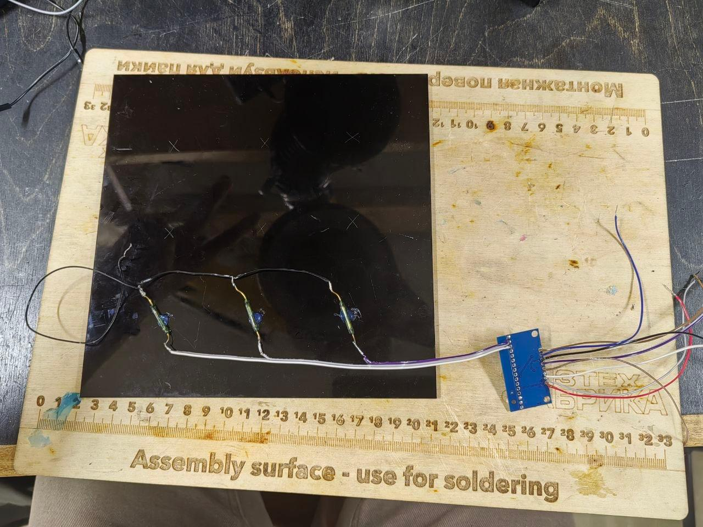

# Автоматические шахматы
Данный репозиторий содержит инструкцию по созданию "автоматических шахмат". Здесь хранятся чертежи установки, функциональные схемы, перечень необходимых компонентов, CAD модели используемых деталей, процесс сборки проекта.

## Описание функционала
Автоматическая доска способна самостоятельно передвигать фигуры. Это открывает следующие возможности: переставлять фигуры дистанционно, управлять ими с помощью бота.

## Команда проекта
- Тюлькин Дмитрий - @dmitrytjulkin
- Бойко Марина - @boyko_marinaa
- Павлов Дмитрий - @lorddmp

## Источники
- https://www.instructables.com/Automated-Chessboard/

## Последние действия
Мы вырезали из оргстекла модель доски 3x3.

К его дну присоединили три геркона, присоединили проводами к мультиплексору и с помощью ардуино проверили работу системы (провели тест мультиплексора).

## Последние коммиты
commit f04c6f
Author: Tyulkin Dmitriy
Date:   Thu Oct 8 15:19:53 2026 +0300

    added files for laser

commit 45d558
Author: Tyulkin Dmitriy
Date:   Sun Sep 27 23:52:28 2026 +0300

    added gif of testing stepper motors
